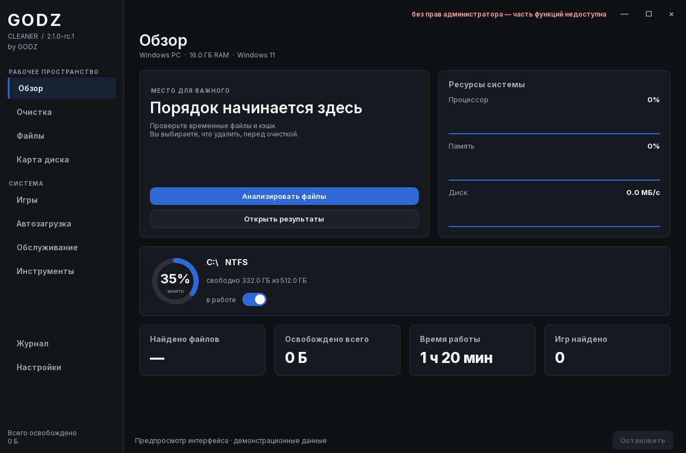

# GODZ CLEANER

**Windows cleanup and maintenance, by GODZ ([@landy-y-Prog](https://github.com/landy-y-Prog)).**

Русский · English | Windows 10 / 11, x64 | Offline

## Скачать / Download

Сборки публикуются в [Releases](https://github.com/landy-y-Prog/godz-cleaner/releases).
Скачайте ZIP, распакуйте всю папку и откройте `GodzCleaner.exe`.
Папка `_internal` должна оставаться рядом с программой.

Download the ZIP from Releases, extract the entire folder and open
`GodzCleaner.exe`. Keep the `_internal` folder next to the executable.

**2.1.0-rc.1 is a release candidate**, not a finished stable release.
Interface, settings persistence, translations and packaging have been checked.
Destructive system operations have not been validated on a clean test machine.

## Возможности

- Анализ временных файлов и кэшей с выбором категорий перед очисткой.
- Поиск больших файлов и дубликатов, карта занятого места.
- Игровые профили с восстановлением предыдущих настроек.
- Управление автозагрузкой и отдельные задачи обслуживания Windows.
- Русский и английский интерфейс, синий или бордовый акцент.
- Настройки анимации, мониторинга, запуска сканирования и исключений.

Язык меняется в **Настройки → Язык приложения** и применяется после перезапуска.
Приложение не отправляет телеметрию. Ссылки на автора открываются в браузере
только по нажатию пользователя.

## Features

Review caches before cleanup, explore disk usage, find large files and duplicates,
manage startup entries and apply reversible gaming settings. Switch the interface
language in **Settings → App language**, then restart the app.

Some actions require administrator rights. Recycle Bin cleanup and file overwrite
are permanent operations with confirmation. Overwriting does not guarantee erasure
on SSDs or cloud storage. Performance changes depend on the system and game.

## Авторство / Authorship

**© 2026 GODZ (landy-y-Prog). All rights reserved.**

Официальный автор — [GODZ](https://github.com/landy-y-Prog).
Этот репозиторий содержит публичные материалы и сборки. Исходный код приложения
закрыт и не предоставляется под открытой лицензией.

This is the official distribution repository. Proprietary application source code
is not included. Third-party components retain their own licenses; see
[COPYRIGHT.txt](COPYRIGHT.txt) and [THIRD_PARTY_NOTICES.txt](THIRD_PARTY_NOTICES.txt).

## Проверка скачивания / Integrity

Compare the archive's SHA-256 with `SHA256SUMS.txt` attached to the same release.
This detects changed downloads; it is not a code-signing certificate.

Report reproducible problems through [Issues](https://github.com/landy-y-Prog/godz-cleaner/issues).
Include the Windows version, app version and steps to reproduce. Remove private
file paths from logs before attaching them.

